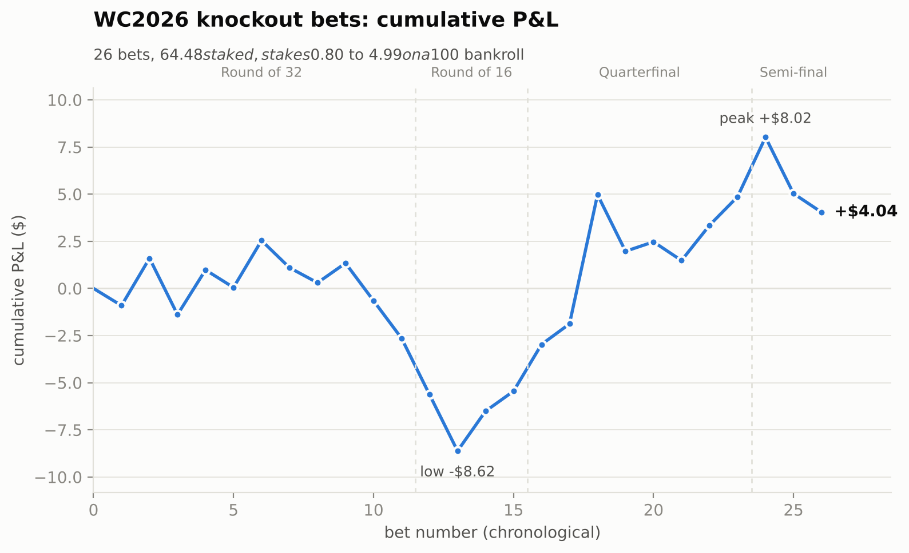
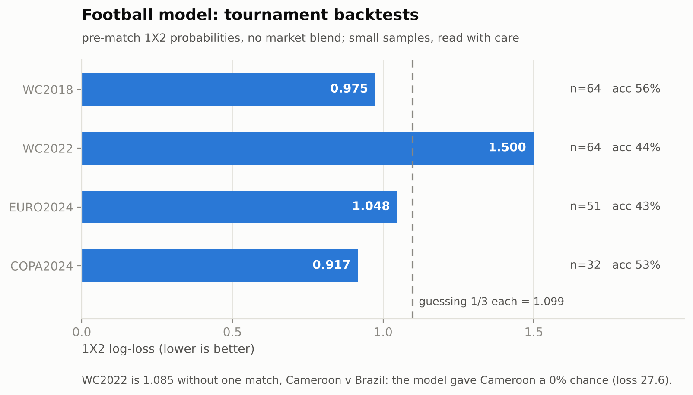
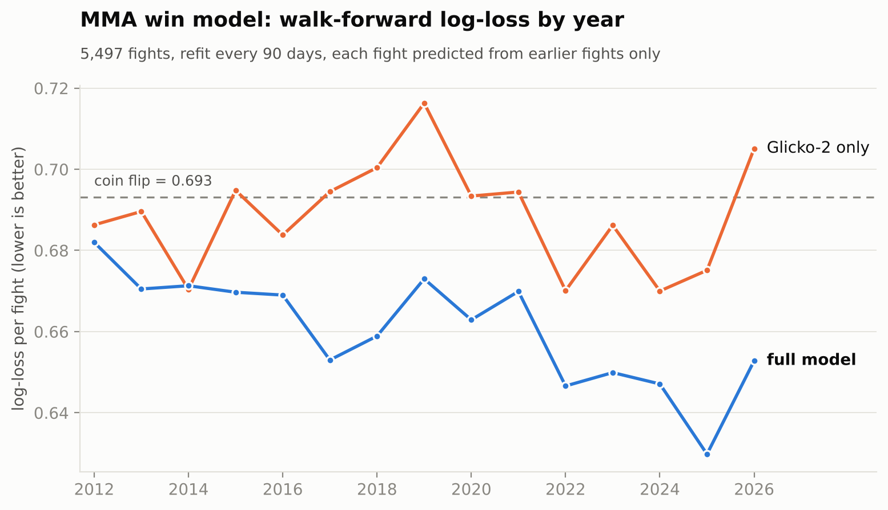

# quantbet

Quantitative research on sports prediction markets. I model matches, compare my prices to a sharp sportsbook (Pinnacle) and to what Kalshi and Polymarket are charging, log every signal, and measure whether I would actually have beaten the closing line.

Built by Varish Nuthi at 00Capital.

> **Where it stands (Nov 13, 2026).** I don't have an edge I can prove, and this repo says so on purpose. My football model has not beaten the market on the holdout I trust most. My MMA model clearly beats a ratings-only baseline but hasn't been tested against market odds yet. Live paper trading started this month, and nothing gets real money until a test I wrote before collecting data says it should.

## At a glance

| | Result |
|---|---|
| WC2026 knockout bets (real money, $100 bankroll) | 26 bets, 13W-13L, **+$4.04** on $64.48 staked (6.3%). Only 3 were model bets |
| Football model, 4 past tournaments (211 matches) | Log-loss 1.143 vs 1.099 for guessing 1/3 each. One match where the model gave 0% explains the gap: 1.017 without it |
| Premier League model vs Pinnacle closing line (81-match holdout) | Market **1.0065**, my model 1.0301. The market wins |
| MMA win model (5,497 walk-forward fights, 2012-2026) | Log-loss 0.657 raw vs 0.689 for ratings-only (coin flip is 0.693). 61% accuracy |
| Live paper trading, EPL + MMA | Running since Nov 11, 2026. 26 signals logged as of Nov 12, none settled, $0 staked by design |

Lower log-loss is better. Full tables, caveats, and the raw logs are in [RESULTS.md](RESULTS.md) and [assets/](assets/).

## What I took from it

- **26 bets prove nothing.** I finished slightly up, but only 3 of the 26 were bets the model told me to make. 12 were my own calls and lost $5.63. The honest read is that the sample says almost nothing about the model.
- **The benchmark is the market, not accuracy.** A model that copies the market has no edge. The repeatable edge I'm testing is line-shopping: buy on Kalshi or Polymarket when the price, after fees, is below what Pinnacle says the outcome is worth. On the Premier League holdout the market beat my model, so the model is a reference, not the thing I bet on.
- **I fixed my measurement before trusting any number.** My first version logged the entry price as the "closing" price, which makes closing line value always read zero. Now every signal is snapshotted every minute near kickoff, and the closing line is the last fresh snapshot before the match starts.
- **A huge "edge" is a bug until proven otherwise.** In my tournament backtests the model disagreed with the market by more than 80% on average. That is the model being wrong about the market, not me finding money. Anything over 20% EV is flagged as an artifact and staked at zero.

## How it works

1. **Pull prices** from Kalshi, Polymarket and The Odds API (Pinnacle) for whatever leagues are in season.
2. **Get a fair price** by removing the margin from Pinnacle's odds. If I can't anchor to Pinnacle, the signal is marked paper-only and stakes nothing.
3. **Compare** against the best ask on Kalshi or Polymarket plus fees. The gap is Pinnacle's probability minus the all-in price.
4. **Size** with tiered fractional Kelly, a 3% per-bet cap, and caps on correlated bets.
5. **Measure** with snapshots, closing line value, and a pre-set verdict rule that returns CONTINUE, STOP or INSUFFICIENT DATA.

The model layer (Dixon-Coles plus LightGBM for football, Glicko-2 plus logistic regression for MMA) feeds step 3 as a second opinion. Details are in [METHODOLOGY.md](METHODOLOGY.md).

## Repo contents

| Path | What's there |
|---|---|
| [METHODOLOGY.md](METHODOLOGY.md) | How the system works and the rules it runs on |
| [RESULTS.md](RESULTS.md) | Every result, with sample sizes and caveats |
| [CHANGELOG.md](CHANGELOG.md) | What changed and when |
| [assets/](assets/) | Trade log, backtest logs, metrics, and charts |
| [sample-code/](sample-code/) | Runnable excerpts: de-vig and Kelly sizing, the market-implied score grid, Glicko-2 |
| [scripts/build_charts.py](scripts/build_charts.py) | Rebuilds every chart and `summary.json` from the raw logs |

The full engine is private. `sample-code/` runs on its own (`pip install numpy scipy && python demo.py`).

## Stack

Python (pandas, NumPy, SciPy, scikit-learn, LightGBM), FastAPI, Next.js and Tailwind for the dashboard, pytest (279 tests). Data from Kalshi, Polymarket, The Odds API and UFC Stats. The system never places orders. It only produces signals.

## Status

- Premier League and MMA watchers are collecting snapshots and paper signals.
- The football model needs a real edge over the closing line before it matters, so the working strategy is line-shopping against Pinnacle.
- Nothing graduates to real stakes until there are at least 150 settled signals with a closing line and the 95% confidence interval on mean closing line value is above zero.
- Next: a live in-game update bot for matches I can't watch, built without a paid AI API.
