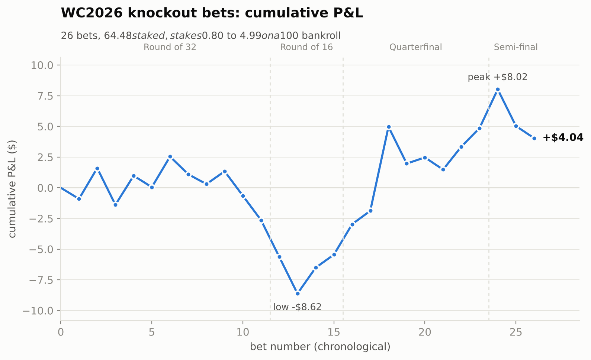
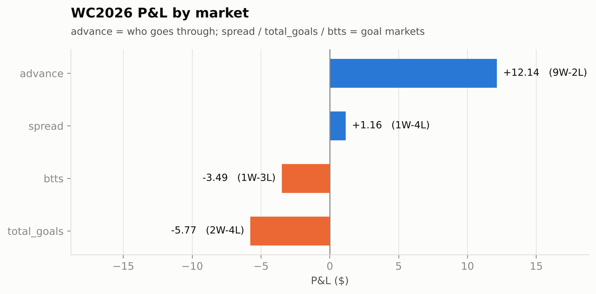
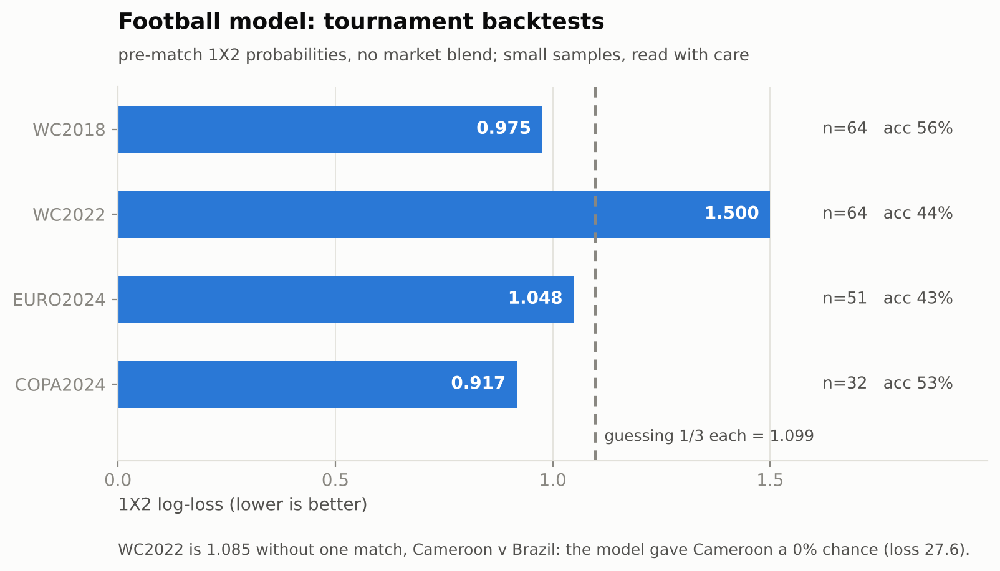
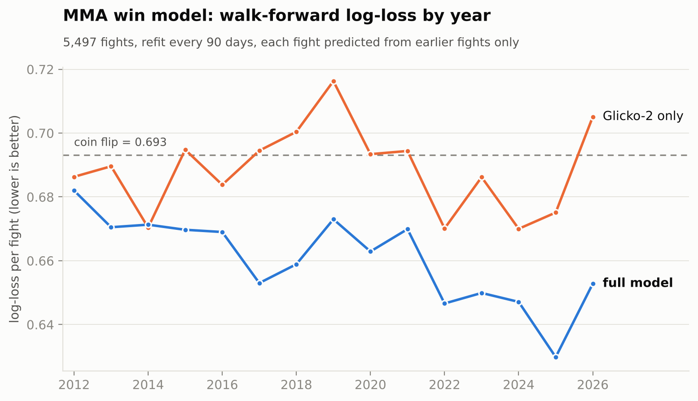

# Results

Everything below comes from the raw logs in [assets/](assets/), except where I say otherwise. `python scripts/build_charts.py` rebuilds the charts and `assets/metrics/summary.json` from those logs.

The short version: the sample sizes are small, the football model has not beaten the market, and the MMA model beats a ratings-only baseline but has not met market odds yet.

## 1. WC2026 knockout bets (real money)

Source: [assets/trade-logs/wc2026_trades.csv](assets/trade-logs/wc2026_trades.csv). Round of 32 to semi-final, Jul 6 to Jul 15, 2026, on a $100 bankroll.

| | |
|---|---|
| Bets | 26 |
| Record | 13W-13L |
| Staked | $64.48 (individual stakes $0.80 to $4.99) |
| P&L | **+$4.04** (6.3% of staked) |
| Peak / low cumulative P&L | +$8.02 / -$8.62 |
| Max drawdown | $11.16 |

**By market**

| Market | Bets | W-L | P&L |
|---|---|---|---|
| advance (who goes through) | 11 | 9-2 | +$12.14 |
| spread | 5 | 1-4 | +$1.16 |
| btts | 4 | 1-3 | -$3.49 |
| total_goals | 6 | 2-4 | -$5.77 |

**By who made the call** (the `source` column in the log)

| Source label | Bets | W-L | Staked | P&L |
|---|---|---|---|---|
| intuition (my own call) | 12 | 4-8 | $33.61 | -$5.63 |
| model | 3 | 2-1 | $5.97 | +$0.18 |
| no label | 11 | 7-4 | $24.90 | +$9.49 |

**By round**

| Round | Bets | W-L | P&L |
|---|---|---|---|
| Round of 32 | 11 | 4-7 | -$2.64 |
| Round of 16 | 4 | 2-2 | -$2.81 |
| Quarterfinal | 8 | 6-2 | +$10.31 |
| Semi-final | 3 | 1-2 | -$0.82 |

**How to read it**

- 26 bets is far too few to say anything about skill. A 13-13 record with a small profit is what luck looks like.
- Only 3 of the 26 were model bets. The profit came mostly from the quarterfinals and from "advance" bets, and none of that tells me the model works.
- I did not measure CLV on these bets. The closing-price column is empty because my first CLV logger used the entry price as the closing price, which always reads zero. I rebuilt it, but these bets predate that.

## 2. Football model: tournament backtests

Source: [assets/backtests/](assets/backtests/). Each tournament is scored leak-free: the model is trained only on matches before the tournament's first match, then predicts every match in it. These are pre-match 1X2 probabilities.

| Tournament | Matches | Accuracy | Log-loss | Brier |
|---|---|---|---|---|
| WC2018 | 64 | 56.3% | 0.975 | 0.578 |
| WC2022 | 64 | 43.8% | 1.500 | 0.661 |
| EURO2024 | 51 | 43.1% | 1.048 | 0.638 |
| COPA2024 | 32 | 53.1% | 0.917 | 0.547 |
| **Pooled** | **211** | **48.8%** | **1.143** | **0.613** |
| Pooled without Cameroon v Brazil | 210 | 49.0% | 1.017 | 0.607 |

Guessing 1/3 for each outcome scores 1.099 log-loss and 0.667 Brier.

**How to read it**

- Pooled, the model scored worse than guessing 1/3 each (1.143 vs 1.099). One match explains it: Cameroon 1-0 Brazil in WC2022, where the model gave Cameroon exactly 0%. That single match costs 27.6 log-loss. I'm showing the numbers with it included, because a model that can output a zero has a real flaw, and dropping the match would hide that. Without it WC2022 is 1.085 and the pooled score is 1.017, which is only a little better than guessing.
- The next worst misses in WC2022 were upsets by underdogs: Saudi Arabia over Argentina, Tunisia over France, and Japan over Spain.
- The zero probably comes from the calibration step saturating, but I haven't confirmed that.
- These tournaments are small and unusual (neutral venues, knockout pressure), so 32 to 64 matches each have a lot of noise.
- Beating "guessing" is a weak bar and doesn't mean beating the market. The market comparison is in the next section.

**The `clv` and `simulated_roi` columns in these CSVs.** They compare my probability to a de-vigged odds snapshot from the morning of the match, and bet any outcome with more than 3% modelled edge. They aren't closing line value, and the mean "edge" is 91% in WC2022 and 82% in Copa. That is the model disagreeing with the market, not me finding money, and I don't use these columns for any claim. WC2018 and EURO2024 have none because historical odds weren't available for them.

## 3. Premier League model vs Pinnacle

On an 81-match EPL holdout, the Pinnacle closing line scored **1.0065** 1X2 log-loss and my model scored **1.0301**. When I searched blend weights between the model and the market, the best 1X2 weight sat on the market close, so the market is the better forecast.

On over/under 2.5 the model was 0.0101 log-loss better than the market-implied grid, but the t-statistic is 0.80 and that isn't significant. I'll re-check at 300+ matches and act only if the t-statistic clears 2.

## 4. MMA win model

Source: [assets/metrics/mma_backtest.json](assets/metrics/mma_backtest.json). Walk-forward from Jan 2012 to Nov 2026: 5,497 fights, refit every 90 days (61 refits), each fight predicted using only earlier fights. The model is trained on 8,988 UFC fights.

| Model | Log-loss | Brier | Accuracy |
|---|---|---|---|
| Coin flip | 0.693 | 0.250 | 50% |
| Glicko-2 ratings only | 0.689 | 0.247 | 55.5% |
| Full model, isotonic-calibrated | 0.659 | 0.233 | 61.4% |
| Full model, raw | 0.657 | 0.232 | 61.4% |

- The full model beats ratings-only by **0.029 log-loss per fight** (standard error 0.0035, 5,497 fights). That is about 8 standard errors, so it is not noise.
- It beats the ratings-only baseline in 14 of 15 years. The exception is 2014, a near tie (0.6713 vs 0.6704).
- Isotonic calibration did not help. On the 4,473 fights where it applied it was slightly worse than raw (+0.0025, standard error 0.0012).
- The method-of-victory model (KO/TKO, submission, decision) scores 0.978 log-loss vs 1.019 for just using base rates, an improvement of 0.041 per fight (standard error 0.0044, 5,525 fights).

**What this doesn't show.** It beats a rating-only baseline and a coin flip. It has not been compared to market odds, so I can't say it beats the closing line. That needs a historical UFC odds file, which I haven't loaded yet.

## 5. Live paper trading

As of Nov 12, 2026, the Premier League and MMA watchers had logged 26 paper signals (23 EPL, 3 MMA). All are open, and every stake is $0 by design. The verdict rule returns INSUFFICIENT DATA for both: 0 of 30 EPL fixtures and 0 of 40 MMA fights have settled with enough qualifying data. The graduation gate needs 150 settled signals.

I have no live results to report yet, and I'd rather say that than show a number the sample can't support.

## 6. What would change my mind

- **Football:** the model beating the market close on a holdout of 300+ matches, or the gap study showing Kalshi and Polymarket regularly cheaper than Pinnacle after fees for long enough to fill an order.
- **MMA:** beating a historical closing-odds benchmark on log-loss.
- **Stop rule:** the verdict returning STOP, meaning the gap share stays under 10% over the minimum sample. In that case I stop.
